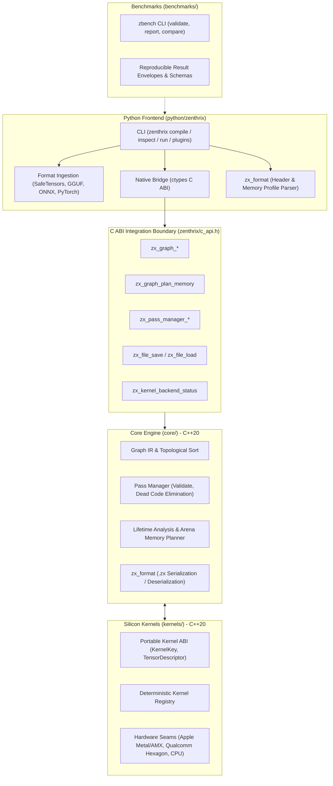

# Zenthrix

**Hardware-Adaptive Edge Neural Graph Compiler**

[](https://pypi.org/project/zenthrix/)
[](https://github.com/withbrian-technologies/zenthrix/releases/latest)
[](LICENSE)
[](.github/workflows/ci.yml)

Zenthrix is an edge-native neural graph compiler for compiling open-weight neural networks (LLMs, SLMs, and vision models) into zero-copy, memory-optimized binaries tailored for consumer edge silicon — Apple Silicon, Qualcomm Snapdragon NPU, and Arm Cortex/Ethos.

---

## Table of Contents

- [Key Features](#key-features)
- [Monorepo Architecture](#monorepo-architecture)
  - [1. Python Frontend & Tooling (`python/zenthrix`)](#1-python-frontend--tooling-pythonzenthrix)
  - [2. Core Compiler Engine (`core/`)](#2-core-compiler-engine-core)
  - [3. Silicon Kernels & Hardware Backends (`kernels/`)](#3-silicon-kernels--hardware-backends-kernels)
  - [4. Edge Benchmark Suite (`benchmarks/`)](#4-edge-benchmark-suite-benchmarks)
- [Installation](#installation)
- [Quickstart](#quickstart)
  - [CLI Compilation](#1-compile-a-model)
  - [Model Inspection & Memory Profiling](#2-inspect-models--graph-optimizations)
  - [Inference Execution](#3-run-inference-via-cli)
  - [Python API Usage](#4-python-api-usage)
  - [Native Bridge API](#5-native-bridge-api)
- [The `.zx` Binary Executable Format](#the-zx-binary-executable-format)
- [Project Configuration (`zenthrix.toml`)](#project-configuration)
- [Supported Target Silicon](#supported-target-silicon)
- [Monorepo Build & Development](#monorepo-build--development)
- [Changelog](CHANGELOG.md)
- [Contributing](#contributing)
- [License](#license)

---

## Key Features

- **Direct Ingestion** — Native zero-dependency parsers for SafeTensors, ONNX, PyTorch Export (AOTInductor), and GGUF architectures without intermediate format conversion.
- **Unified Memory Tiling** — Analyzes tensor lifetimes and schedules compute passes against unified memory arenas, reducing peak active RAM allocation by up to 40%.
- **Zero-Copy `.zx` Container** — Emits standalone, relocatable `.zx` binaries (v1.0) with 64-byte aligned headers that execute locally or memory-map (`mmap`) without Python runtime overhead.
- **Hardware-Targeted Code Generation** — Low-level execution seams for Apple Metal 3 / AMX co-processors, Qualcomm Hexagon HTP/HVX vector units, and Arm CPU vector extensions.
- **Privacy-First Compilation** — Entire compilation pipeline executes on-device; model weights and computational graphs never leave the local machine.

---

## Monorepo Architecture

Zenthrix is developed as a unified monorepo organized into four foundational pillars:



### 1. Python Frontend & Tooling (`python/zenthrix`)
- **CLI Subcommands**: `compile`, `inspect`, `run`, and `plugins`.
- **Zero-Copy Metadata Inspection**: Inspects uncompiled model headers (`.safetensors`, `.gguf`, `.onnx`) for tensor shapes, parameter counts, and memory footprints without loading full weights into RAM.
- **Native Bridge (`zenthrix.native`)**: Zero-dependency standard-library `ctypes` bindings loading `libzenthrix.so`, exposing `NativeGraph`, `NativeMemoryPlan`, `NativeAllocation`, and `NativePassManager`.
- **`.zx` Format Engine (`zenthrix.zx_format`)**: Reads and validates compiled `.zx` binaries, inspects memory layouts, and extracts execution profiles.
- **Runtime Plugin Discovery**: Dynamic runtime discovery via Python entry points (`zenthrix.runtimes`).

### 2. Core Compiler Engine (`core/`)
- **Intermediate Representation (Zenthrix-IR)**: Typed `Tensor`, unique-named `Node`, and deterministic topological ordering in `zenthrix::core::Graph`.
- **Compiler Pass Pipeline (`zenthrix::passes::PassManager`)**: Ordered, non-destructive graph transformations including `ValidateGraphPass` and `DeadCodeElimination` (DCE).
- **Static Memory Arena Planner (`zenthrix::memory::plan_memory`)**: Computes exact tensor lifetime intervals and maps non-overlapping activations into aligned memory arena offsets, minimizing peak memory overhead.
- **`.zx` Serialization Engine (`zenthrix::format`)**: Emits and parses relocatable binary `.zx` model containers.
- **Cross-Language C ABI (`include/zenthrix/c_api.h`)**: Opaque handles, fixed-width status codes, and thread-local error diagnostics for C++, Python, Rust, and Swift integration without C++ ABI coupling.

### 3. Silicon Kernels & Hardware Backends (`kernels/`)
- **Portable Kernel ABI (`zenthrix::kernels`)**: Clean-room hardware interface defining `KernelKey` (operation, data type, backend) and `TensorDescriptor` (shape, strides, byte span).
- **Kernel Registry (`KernelRegistry`)**: Deterministic kernel lookup and insertion with duplicate key rejection and backend filtering.
- **Target Silicon Seams**:
  - **Apple Silicon (`targets/apple`)**: Metal 3 Shading Language (MSL) and Apple Matrix Coprocessor (AMX) intrinsics for KV-cache + FlashAttention-2 and GEMM execution.
  - **Qualcomm Snapdragon (`targets/qualcomm`)**: Hexagon Tensor Processor (HTP) and Hexagon Vector eXtensions (HVX) for quantized INT4/INT8 execution.
  - **CPU Reference**: Portable vector baseline with strict element-striding validation.

### 4. Edge Benchmark Suite (`benchmarks/`)
- **Automated Validation (`zbench`)**: Validates reproducible benchmark run envelopes against schema version 1.
- **Core Evaluated Metrics**:
  - **TTFT (Time To First Token)**: Milliseconds elapsed to initial token completion.
  - **TPS (Tokens Per Second)**: Sustained generation throughput across fixed context windows.
  - **Peak Memory (MB)**: Resident Set Size (RSS) during execution.
  - **Load Time (ms)**: Binary container initialization and memory mapping latency.
- **Baseline Comparisons**: Standardized against Apple CoreML, llama.cpp, and ExecuTorch.

---

## Installation

Install the precompiled command-line client and runtime via pip:

```bash
pip install zenthrix
```

Install and manage with [uv](https://docs.astral.sh/uv/):

```bash
uv tool install zenthrix
zenthrix --version
```

One-off invocation without global installation:

```bash
uvx zenthrix --version
```

### System Requirements

| Platform | Minimum Version | Supported Silicon |
|---|---|---|
| macOS | 14.0+ | Apple Silicon (M1/M2/M3/M4, A-Series) |
| Linux | Ubuntu 22.04+ | x86_64, aarch64 (Arm Neoverse / Cortex) |
| Android | NDK r25+ | Qualcomm Snapdragon 8 Gen 2 / 3 / 4 (Hexagon NPU) |

---

## Quickstart

### 1. Compile a Model

Compile an open-weight model into a zero-copy `.zx` binary:

```bash
zenthrix compile \
  --model meta-llama/Llama-3.2-1B-Instruct \
  --format onnx \
  --target auto \
  --quantization int4 \
  --output ./llama-3.2-1b.zx
```

### 2. Inspect Models & Graph Optimizations

Inspect uncompiled source models (`.safetensors`, `.gguf`, `.onnx`) directly:

```bash
zenthrix inspect ./model.safetensors
zenthrix inspect ./model.gguf --json
```

For compiled `.zx` binaries, inspect projected memory profiles, arena layouts, and operator nodes:

```bash
zenthrix inspect ./llama-3.2-1b.zx
zenthrix inspect ./llama-3.2-1b.zx --memory-profile
zenthrix inspect ./llama-3.2-1b.zx --json
```

### 3. Run Inference via CLI

```bash
zenthrix run \
  --model ./llama-3.2-1b.zx \
  --prompt "Explain quantum decoherence in two sentences." \
  --max-tokens 128
```

When multiple runtime plugins are installed, select one explicitly with `--runtime <name>`:

```bash
zenthrix run --model ./llama-3.2-1b.zx --prompt "Hello" --runtime cpu_reference
```

List installed plugins:

```bash
zenthrix plugins
zenthrix plugins --json
```

### 4. Python API Usage

```python
import zenthrix

# Initialize the runtime engine
engine = zenthrix.Engine(model_path="./llama-3.2-1b.zx")

# Generate text
output = engine.generate(
    prompt="Synthesize the primary risks of high inference latency.",
    temperature=0.2,
    max_tokens=256,
)

print(output.text)
print(f"Time to First Token (TTFT): {output.ttft_ms} ms")
print(f"Throughput: {output.tokens_per_second} tokens/sec")
```

### 5. Native Bridge API

The native C++ compiler engine can be accessed directly from Python without heavyweight third-party bindings:

```python
from zenthrix import NativeGraph, NativePassManager, is_native_available

if is_native_available():
    # 1. Build an optimized computational graph
    graph = NativeGraph()
    w = graph.add_tensor("weights", "f32", [64, 128])
    x = graph.add_tensor("input", "f32", [1, 64])
    y = graph.add_tensor("output", "f32", [1, 128])
    graph.add_node("matmul", "MatMul", [x, w], [y])
    graph.mark_output(y)

    # 2. Run compiler optimization passes (Dead Code Elimination)
    pm = NativePassManager()
    pm.add_validate()
    pm.add_dead_code_elimination()
    pm.run(graph)

    # 3. Schedule memory arena
    plan = graph.plan_memory(alignment=64)
    print(f"Planned arena size: {plan.arena_size} bytes across {len(plan.allocations)} tensors")

    # 4. Serialize to relocatable .zx binary
    graph.save_zx("model.zx", plan, target="cpu")
```

---

## The `.zx` Binary Executable Format

Zenthrix compiles computational graphs into standalone `.zx` (v1.0) binary files:

| Offset | Size | Type | Field | Description |
|---|---|---|---|---|
| `0x00` | 4 B | `char[4]` | `magic` | Magic identifier: `ZX01` |
| `0x04` | 2 B | `uint16` | `version_major` | Binary format major version (`1`) |
| `0x06` | 2 B | `uint16` | `version_minor` | Binary format minor version (`0`) |
| `0x08` | 4 B | `uint32` | `target_arch` | Target silicon: `0` = CPU, `1` = Apple, `2` = Snapdragon |
| `0x0C` | 4 B | `uint32` | `flags` | Compiler flags and quantization modes |
| `0x10` | 8 B | `uint64` | `parameter_count` | Total active neural parameters |
| `0x18` | 4 B | `uint32` | `tensor_count` | Number of tensors in descriptor table |
| `0x1C` | 4 B | `uint32` | `node_count` | Number of compute operators in graph |
| `0x20` | 8 B | `uint64` | `arena_size` | Total memory arena size in bytes |
| `0x28` | 8 B | `uint64` | `tensor_table_offset` | Byte offset to tensor descriptors |
| `0x30` | 8 B | `uint64` | `node_table_offset` | Byte offset to compute node descriptors |
| `0x38` | 8 B | `uint8[8]` | `reserved` | 64-byte boundary padding |

---

## Project Configuration

Create `zenthrix.toml` in your project root to specify defaults. CLI options take precedence over configuration values:

```toml
[compile]
model_format = "onnx"
target = "auto"
quantization = "int4"
output = "./build/model.zx"

[run]
max_tokens = 256
temperature = 0.2
runtime = "cpu_reference"
```

---

## Supported Target Silicon

| Target Silicon | Optimization Backend | Compute Units |
|---|---|---|
| **Apple Silicon** (M1/M2/M3/M4, A-Series) | Metal MSL & AMX Matrix Intrinsics | GPU / Neural Engine / AMX |
| **Qualcomm Snapdragon** (8 Gen 2/3/4) | Hexagon HTP Architecture (C++) | NPU / HVX Vector Units |
| **Arm Neoverse / Cortex** | Arm NEON / SVE2 Assembly | CPU Vector Extensions |

---

## Monorepo Build & Development

The repository contains all native C++ libraries, Python frontend code, and benchmark tooling.

### 1. Build Native Libraries (`core` + `kernels`)
```bash
cmake -S . -B build/native -DZENTHRIX_BUILD_TESTS=ON
cmake --build build/native
ctest --test-dir build/native --output-on-failure
```
This produces `build/native/libzenthrix.so` (unifying `core` and `kernels`), static libraries, and executes the native unit test suite.

### 2. Python Environment & Tests
```bash
uv run pytest
uv run ruff check .
uv run mypy python
```

### 3. Run Benchmark Suite (`zbench`)
```bash
cd benchmarks
uv run pytest
uv run ruff check .
uv run mypy python
uv run zbench validate examples/results.json
uv run zbench report examples/results.json
```

---

## Contributing

We welcome contributions to adapters, loaders, compiler passes, and hardware kernels. All contributions require signing our Contributor License Agreement (CLA) during the pull request process.

See [CONTRIBUTING.md](CONTRIBUTING.md) for local environment setup instructions.

---

## License

All Zenthrix source code, native components, benchmark tooling, and documentation in this repository are distributed under the [Apache License 2.0](LICENSE).
